# CloudGuard Lite

CloudGuard Lite is a production-style portfolio project for lightweight cloud security posture management. It combines guided organisation setup, a practical self-assessment, demo scanning, Prowler-backed provider scanning, internal control mapping, deterministic policy generation, report export, audit logging, and background job architecture.

It is not a compliance authority and does not claim certification, audit completion, or legal compliance.

## Architecture

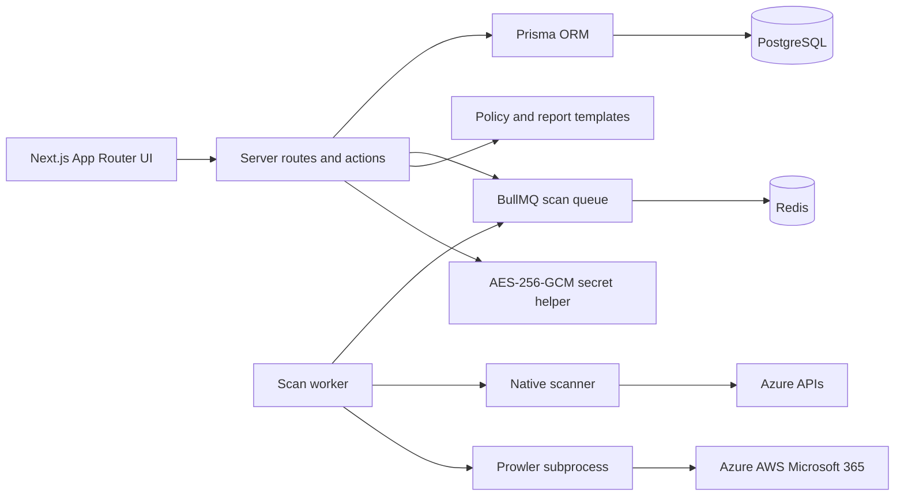

## Product Flow

The main vertical slice is:

1. Create or review an organisation profile.
2. Complete a guided security assessment.
3. Run a demo Azure scan without credentials.
4. Review findings and severity.
5. Map findings and answers to internal controls.
6. Generate and edit internal policies.
7. Export a Markdown report.
8. Review audit events for important actions.

## Data Model

Prisma models cover:

- `User`, `Organisation`, and `Member` with roles: owner, admin, contributor, viewer.
- `Assessment` and `AssessmentAnswer` for questionnaire state.
- `CloudConnection` with encrypted secrets and no raw secret return path.
- `ScanRun` and `Finding` for cloud posture checks.
- `Policy` and `PolicyVersion` for editable generated documents.
- `AuditLog` for security-relevant events.

See [prisma/schema.prisma](./prisma/schema.prisma).

## Scanner Architecture

Scanner checks normalize to:

- `checkId`
- `title`
- `description`
- `severity`
- `status`
- `evidence`
- `affectedResource`
- `remediation`
- `complianceTags`
- `engine`

Demo mode lives in [lib/scanner/demo-azure.ts](./lib/scanner/demo-azure.ts) and produces realistic Azure findings. Real Azure scanning starts in [lib/scanner/azure-real.ts](./lib/scanner/azure-real.ts) with service principal authentication and pragmatic resource group tag checks.

Prowler is integrated as the fast compliance-scanning engine for Azure, AWS, and Microsoft 365. The worker image installs a pinned Prowler version and [lib/prowler/adapter.ts](./lib/prowler/adapter.ts) normalizes JSON-OCSF output into CloudGuard Lite findings.

Provider entry points:

- [lib/scanner/azure-real.ts](./lib/scanner/azure-real.ts): native Azure checks plus Prowler.
- [lib/scanner/aws-prowler.ts](./lib/scanner/aws-prowler.ts): AWS Prowler scan path.
- [lib/scanner/m365-prowler.ts](./lib/scanner/m365-prowler.ts): Microsoft 365 Prowler scan path.

See [docs/CLOUD_SCANNING.md](./docs/CLOUD_SCANNING.md).

## Policy Generation

Deterministic templates work without an LLM key. Templates use:

- Organisation profile data.
- Assessment answers.
- Related cloud findings.
- Control mappings.

LLM enhancement is isolated behind [lib/policies/llm.ts](./lib/policies/llm.ts). The system prompt instructs the model not to make legal claims, not to invent certifications, and to keep policy wording practical.

## Security Model

- Server-side route validation uses Zod.
- Organisation authorization helpers are in [lib/auth/authorization.ts](./lib/auth/authorization.ts).
- Cloud secrets are encrypted with AES-256-GCM in [lib/crypto/encryption.ts](./lib/crypto/encryption.ts).
- Demo credentials are not required for the main workflow.
- Audit log coverage includes profile completion, scan completion, policy generation, policy edits, and report export.

## Local Setup

```bash
npm install
cp .env.example .env
npx prisma generate
npm run dev
```

Open `http://localhost:3000`.

## Docker Compose

```bash
docker compose up --build
```

Services:

- `app`: Next.js application.
- `postgres`: PostgreSQL database.
- `redis`: BullMQ queue backend.
- `worker`: scan worker process.

## Environment Variables

| Variable | Purpose |
| --- | --- |
| `DATABASE_URL` | PostgreSQL connection string |
| `REDIS_URL` | Redis connection string for BullMQ |
| `APP_ENCRYPTION_KEY` | Base64 32-byte key or passphrase for local encryption |
| `OPENAI_API_KEY` | Optional key for LLM policy enhancement |
| `OPENAI_BASE_URL` | Optional OpenAI-compatible base URL |
| `OPENAI_MODEL` | Optional model name |
| `NEXT_PUBLIC_APP_URL` | Public app URL |
| `PROWLER_VERSION` | Pinned Prowler version installed in the worker image |
| `PROWLER_BIN` | Prowler executable path |
| `PROWLER_CONCURRENCY` | Per-scan Prowler concurrency cap |
| `PROWLER_SEVERITY` | Comma-separated severity filter |
| `PROWLER_COMPLIANCE_AZURE` | Azure compliance profile |
| `PROWLER_COMPLIANCE_AWS` | AWS compliance profile |
| `PROWLER_COMPLIANCE_M365` | Microsoft 365 compliance profile |

## Testing

```bash
npm run test
npm run e2e
```

Coverage includes assessment scoring, control mapping, policy generation, encryption, scanner result normalization, Prowler OCSF adaptation, Prowler runner configuration, and organisation authorization. Playwright covers the demo workflow from landing page to report.

## Screenshots

The screenshots below are full-page captures from the local Next.js app at a 1440px desktop viewport.

### Landing and Dashboard

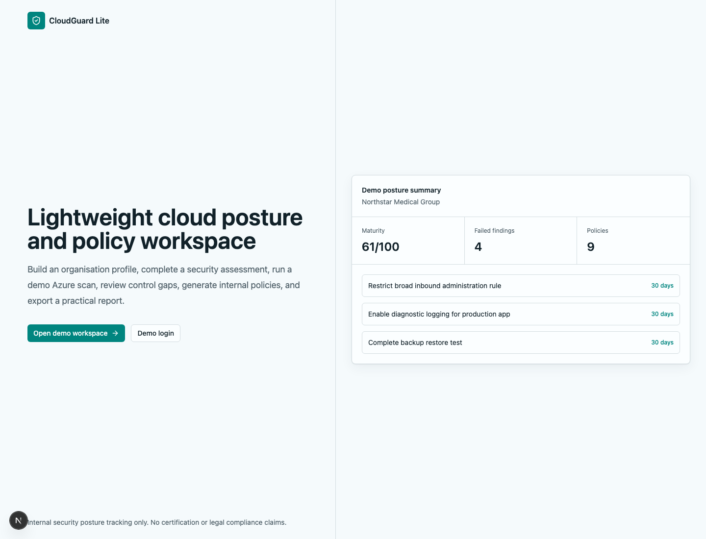

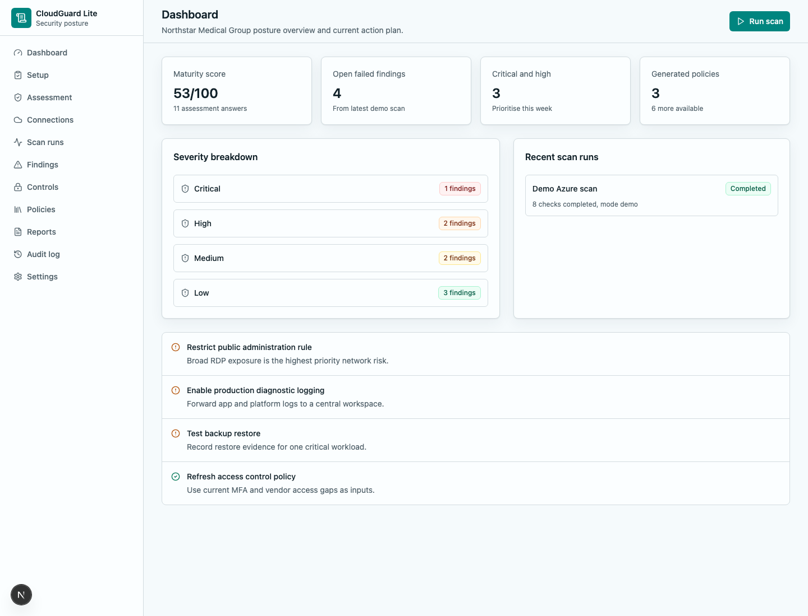

### Setup and Assessment

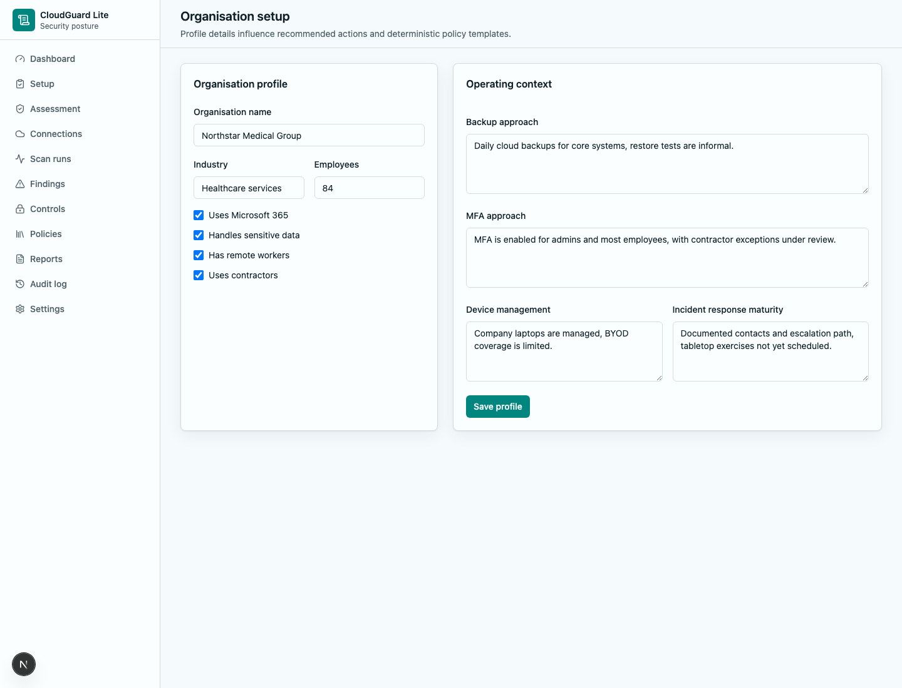

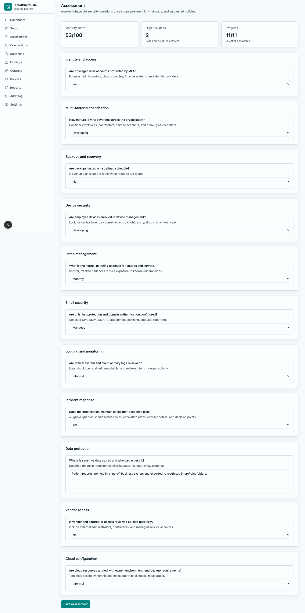

### Cloud Scanning

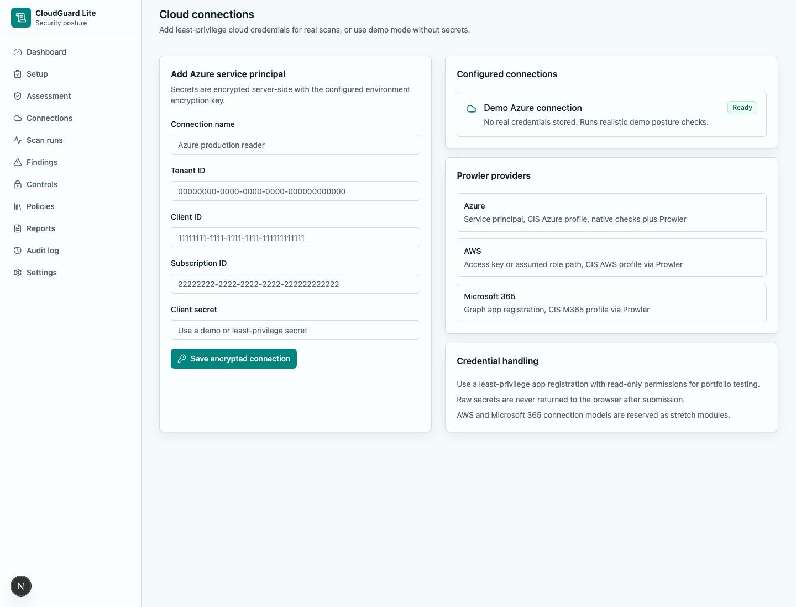

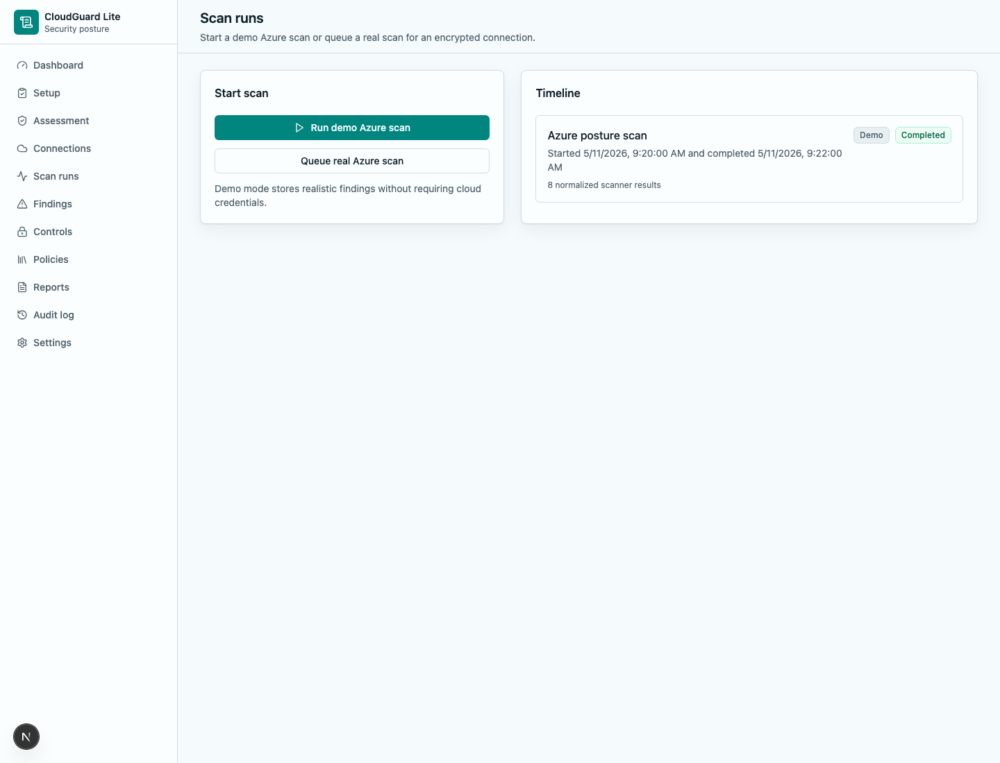

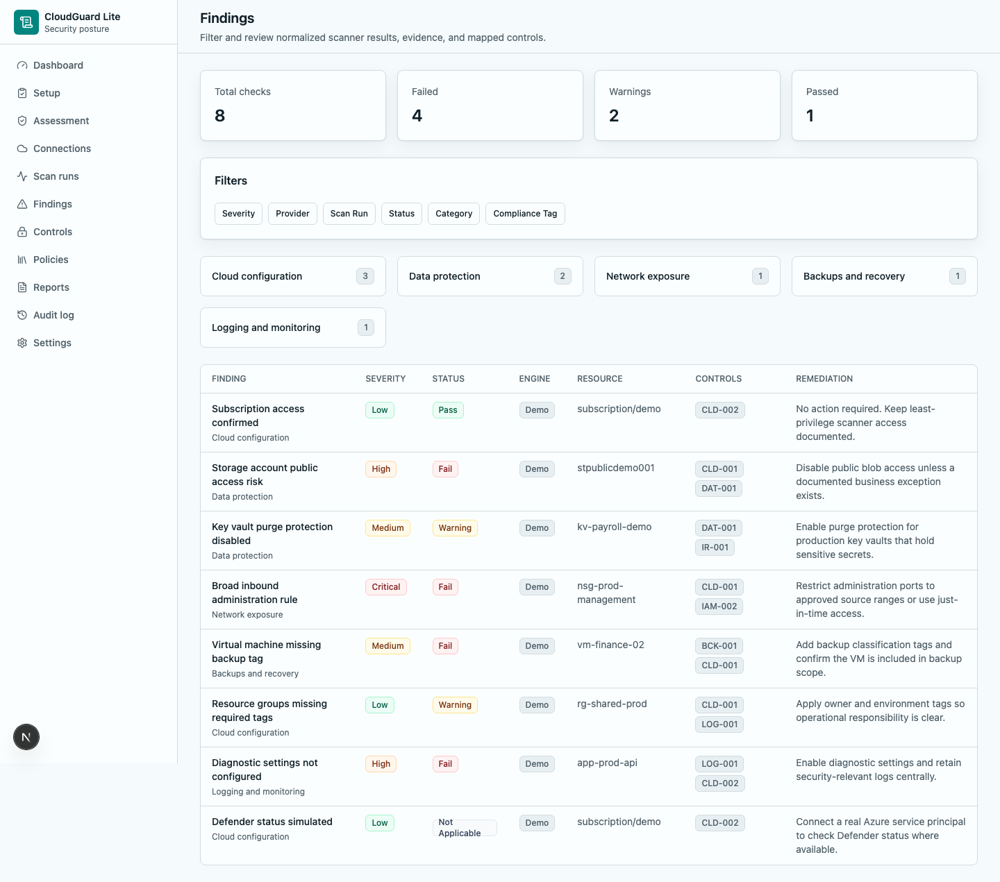

### Controls and Policies

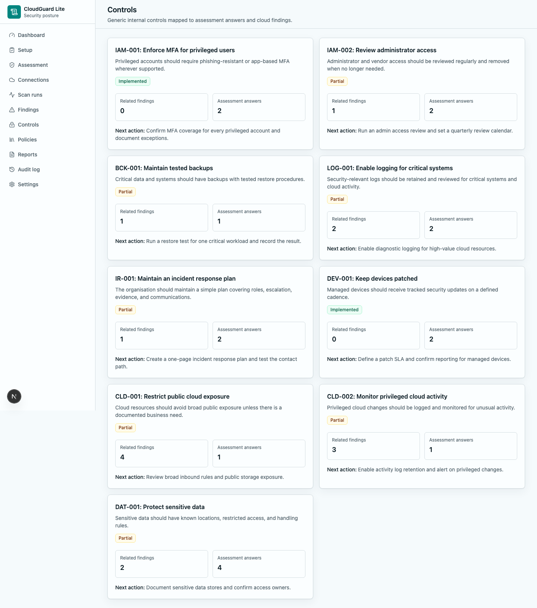

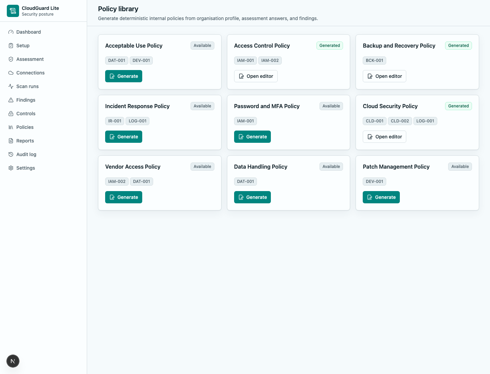

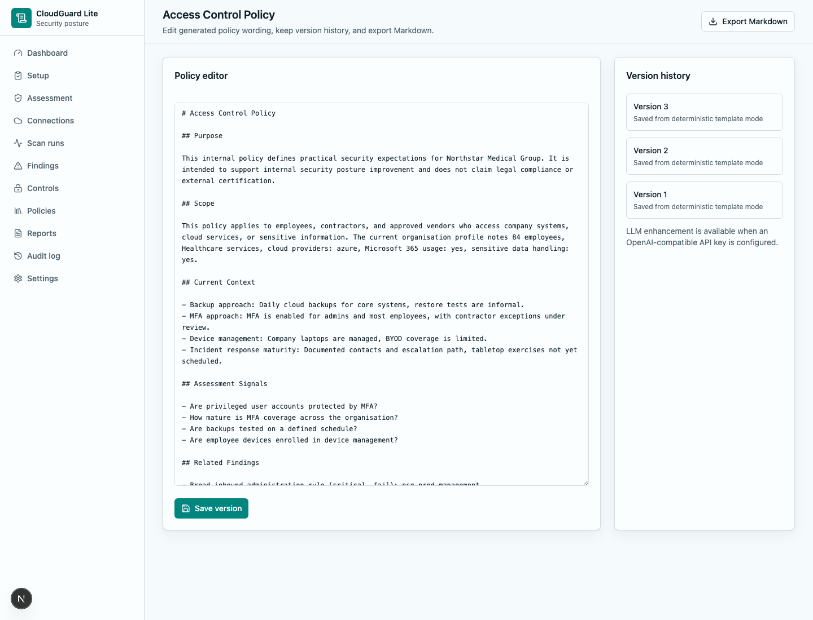

### Reports and Audit

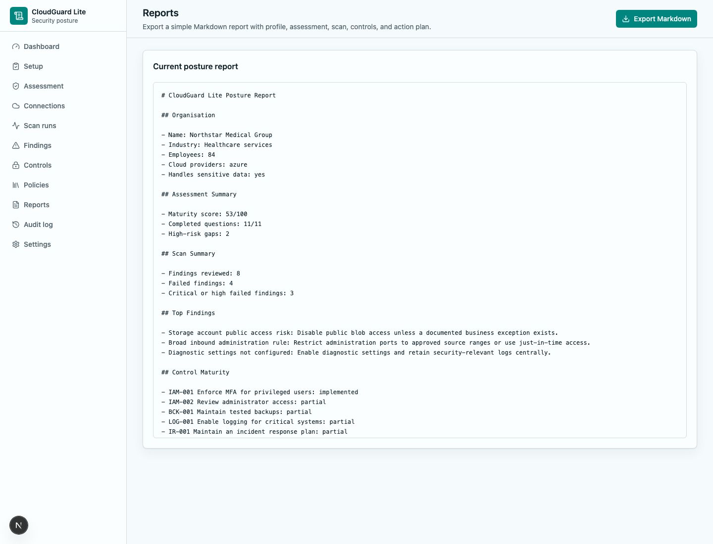

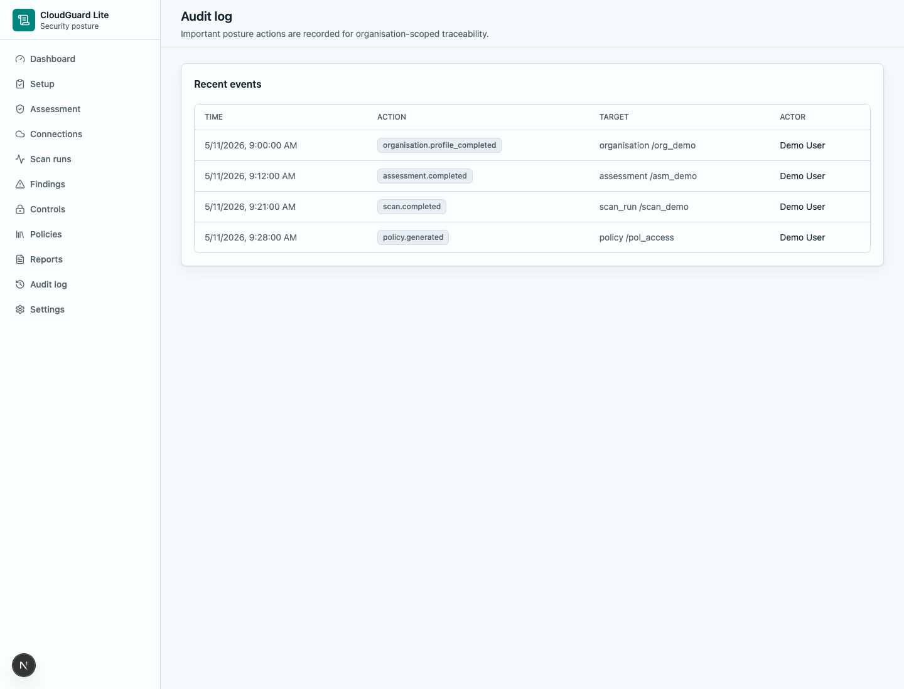

## Future Roadmap

- Persist demo workflow records through Prisma instead of fixture-backed UI.
- Persist encrypted AWS and Microsoft 365 connection records through the UI.
- Expand native Azure checks for storage, key vault, network security groups, diagnostics, and VM tags alongside Prowler.
- Add PDF export.
- Add multi-user invitation and member management UI.
- Add scheduled scans and notification rules.
